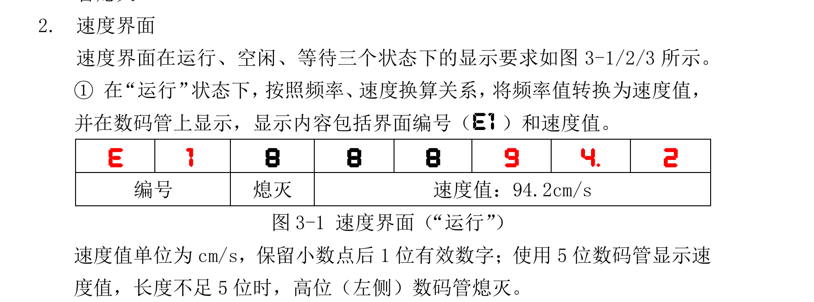
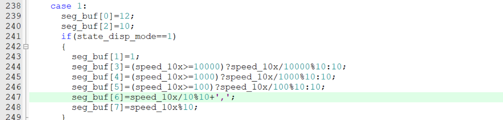
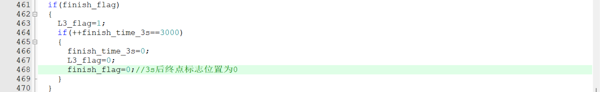
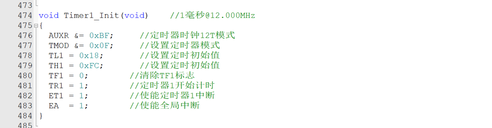
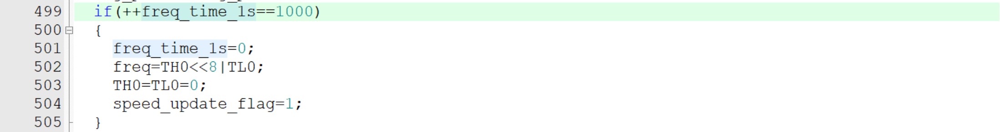
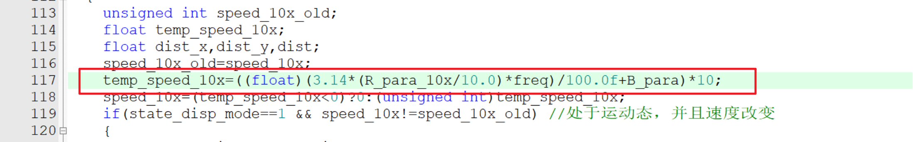
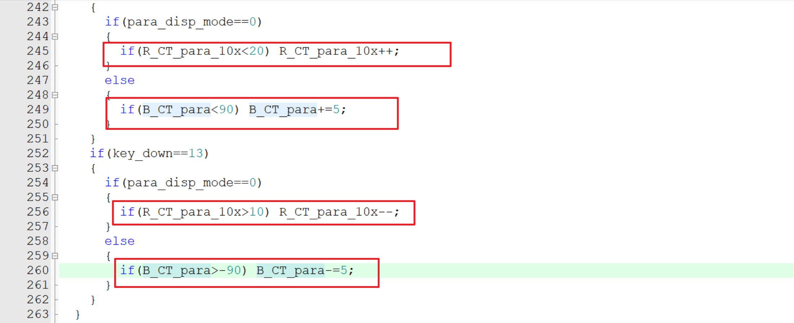
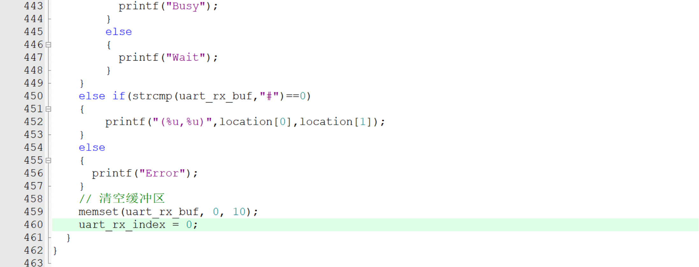

# 1

速度显示数码管的第7位(seg_buf[6])是一定会显示的，如果速度值的10倍(speed_10x)为0.0几，seg_buf[6]也会显示0和小数点

# 2

到达终点L3亮3s后，把到达终点标志位置为0，防止L3_flag再被触发

# 3

运动控制函数，速度计算函数，按键s4的代码掌握不牢

# 4

定时器1要记得开全局中断

# 5

频率1000ms计时器要记得写++ !!!

# 6

速度计算公式别写错！！！

# 7

没到上限才可以加，没到下限才可以减，参数要对应不要写成 if(B_CT_para>-90) R_CT_para_10x-=5;

# 8

串口超时解析完要记得清空缓冲区和重置Uart_Rx_Index(串口接收数据索引值)