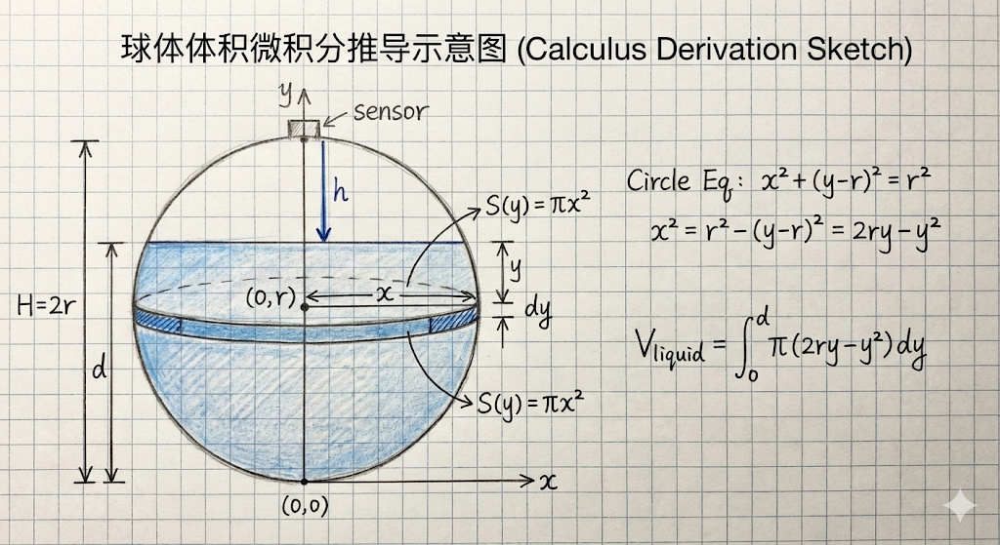
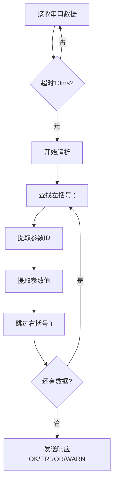
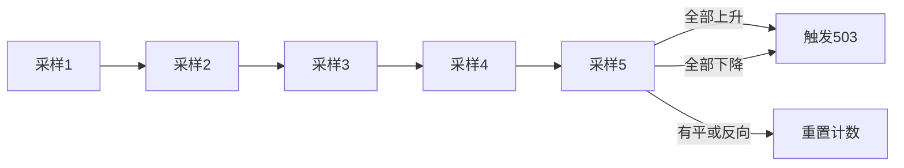
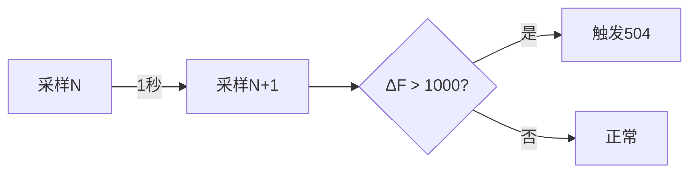
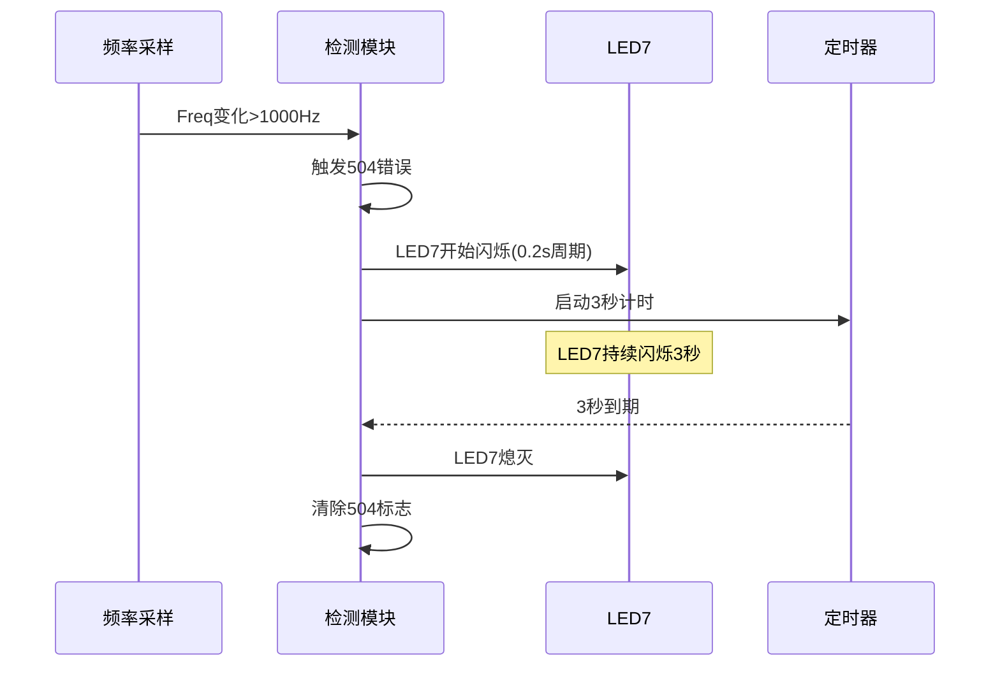

# 一、题目概览

## 1.1 三大核心技术难点

### 难点1: 变长协议解析与状态机设计

**技术挑战**:
- 协议格式为`(ID,值)(ID,值)...`,参数个数不固定
- 需要处理括号配对、逗号分隔、字符串终止等边界情况
- 支持米↔厘米自动换算,避免单位混淆

**解决方案**:
- **有限状态机**: 定义"寻找左括号→提取ID→跳过逗号→提取值→跳过右括号"五状态流程
- **边界防护**: 每次字符读取前检查缓冲区索引,防止越界访问
- **单位统一**: 外部接口使用米(m),内部存储统一为厘米(cm),转换函数支持一位小数精度

### 难点2: 球冠体积微积分推导

**数学挑战**:
- 球体非柱状容器,液位高度与体积呈非线性关系
- 需要通过微积分建立精确的数学模型

**推导方法**:
- **圆盘积分法(Disk Method)**: 将球冠视为无数薄圆盘的叠加
- **截面方程建立**: 利用球的标准方程推导高度$y$处的截面半径$x(y)$
- **定积分求解**: $$V_{液体} = \int_{0}^{d} \pi x^2(y) \, dy = \frac{\pi d^2(3r-d)}{3}$$

### 难点3: 嵌入式系统资源优化

**硬件约束**:
- STC15F2K60S2: 60KB ROM / 2KB RAM,无浮点运算单元
- 需要管理8个配置参数、5个标定点、64字节串口缓冲区、温度/频率历史值等

**优化策略**:
- **分段内存管理**: 高频变量用idata(256B直接寻址),缓冲区用pdata(页寻址),配置用xdata(扩展寻址)
- **定点数存储**: 所有小数使用100倍值表示,如3.45m存储为345,避免float运算

---

# 二、数学建模与核心算法

## 2.1 五点标定法理论与实现

### 2.1.1 分段线性插值模型

传感器并不是完美的直线的（$y=kx+b$），它存在非线性误差。

我们用了 5 个标定点 $(x_0, y_0), (x_1, y_1), \dots, (x_4, y_4)$。

这里：

- $x$ 轴（自变量）：**电压 (Voltage)**
- $y$ 轴（因变量）：**重量 (Weight)**

这就构成了一个**分段函数 (Piecewise Function)**。假设输入电压是 $x$，我们定义的函数 $F(x)$ 如下：

$$F(x) = \begin{cases} L_1(x), & x_0 \le x < x_1 \\ L_2(x), & x_1 \le x < x_2 \\ L_3(x), & x_2 \le x < x_3 \\ L_4(x), & x_3 \le x \le x_4 \\ \end{cases}$$

每一段 $L_i(x)$ 都是一条独立的直线。这比用一条直线（单点标定）去硬套所有数据要精确得多！

### 2.1.2 区间内的计算：两点式方程

当程序判断出电压 $x$ 落在第 $i$ 个区间 $[x_i, x_{i+1}]$ 之间时（比如 1000mV 到 2500mV 之间），数学上我们利用这两个端点来确定一条直线。

使用的公式是解析几何中的 **“直线方程两点式”**：

$$\frac{y - y_i}{y_{i+1} - y_i} = \frac{x - x_i}{x_{i+1} - x_i}$$

为了求出当前的重量 $y$，我们需要对这个公式进行移项变形。

**变形第一步（求斜率）：**

$$y - y_i = \underbrace{\frac{y_{i+1} - y_i}{x_{i+1} - x_i}}_{\text{斜率 } k} \times (x - x_i)$$

这里的斜率 $k$ 代表了**在这个特定的电压区间内，每增加 1mV 电压，重量增加多少**。

**变形第二步（最终公式）：**

$$y = y_i + \frac{y_{i+1} - y_i}{x_{i+1} - x_i} \times (x - x_i)$$

### 2.1.3 物理意义与几何解释 

将公式改写为增量形式：

$$\text{当前重量} = \text{起始重量} + \text{增量部分}$$

其中 **“增量部分”** 是最关键的：

$$\text{增量} = \text{电压偏差} \times \text{局部灵敏度}$$

- **电压偏差 $(x - x_i)$**：当前电压比这一段的“起点电压”的偏移量
- **局部灵敏度 $\frac{y_{i+1} - y_i}{x_{i+1} - x_i}$**：在这个小区间里，传感器的变化率:

为什么要叫“动态计算”？

- 区间斜率大时，单位电压变化对应较大的重量变化；
- 区间斜率小时，较大的电压变化仅对应较小的重量变化。

### 2.1.4 整数运算优化技巧

在51单片机整数运算中,运算顺序直接影响计算精度。

数学公式是：

$$y = y_i + (x - x_i) \times \frac{\Delta y}{\Delta x}$$

但在计算机（特别是 51 单片机）里，如果先算 $\frac{\Delta y}{\Delta x}$，会得到类似 $0.1234$ 这样的小数。

整数截断导致精度丢失，结果变为 $0$！ 

所以我们在计算顺序上利用了**乘法结合律**：

$$y = y_i + \frac{(x - x_i) \times \Delta y}{\Delta x}$$

**数学上这两者是等价的，但在工程上：**

- **前者**：先除（变0）再乘 $\to$ 结果误差巨大。
- **后者**：先乘（变大）再除 $\to$ 结果保留了精度。

## 2.2 多容器体积计算模型

### 2.2.1 参数定义
本算法旨在通过超声波传感器测量的液面距离（$h$），结合容器的几何尺寸参数，计算容器内液体的实时体积（$V_{liquid}$）及剩余空间体积（$V_{remain}$）。
定义通用 

- $h$：超声波传感器探头至液面的垂直距离（测距读数）。
- $d$：容器内液体的实际深度（液位高度）。
对于所有容器模型，液位高度 $d$ 与测距读数 $h$ 的关系均为：
$$d = H_{total} - h$$
其中 $H_{total}$ 为容器内部总高度（对于球体，$H_{total}$ 即为直径 $2r$）。

### 2.2.2 球体容器 (Spherical Container) 体积计算

**模型构建**
设定球体半径为 $r$，容器总高度为 $2r$。
建立笛卡尔直角坐标系：以球体最底端切点为原点 $(0,0,0)$，垂直向上为 $y$ 轴正方向。

**微积分推导过程**
采用定积分法（Disk Method）计算体积。将球体内的液体视为沿 $y$ 轴方向堆叠的无数个无限薄的水平圆盘切片。



1. 建立截面方程
   在高度 $y$ 处（$0 \le y \le 2r$），球体的水平截面是一个圆。
   球心坐标为 $(0, r)$。根据圆的标准方程 $x^2 + (y-r)^2 = r^2$，可得截面圆半径 $x$ 与高度 $y$ 的关系：
   $$x^2 = r^2 - (y - r)^2$$
   展开右式：
   $$x^2 = r^2 - (y^2 - 2ry + r^2) = 2ry - y^2$$
2. 建立面积微元
   高度 $y$ 处的截面面积 $S(y)$ 为：
   $$S(y) = \pi x^2 = \pi (2ry - y^2)$$
3. 建立体积积分
   液体体积 $V_{liquid}$ 为截面面积从底部 ($y=0$) 到液面高度 ($y=d$) 的定积分：
   $$V_{liquid} = \int_{0}^{d} S(y) \, dy = \int_{0}^{d} \pi (2ry - y^2) \, dy$$
4. 求解积分
   提取常数 $\pi$，对 $y$ 进行积分运算：
   $$V_{liquid} = \pi \left[ \int 2ry \, dy - \int y^2 \, dy \right]_{0}^{d}$$
   $$V_{liquid} = \pi \left[ r y^2 - \frac{y^3}{3} \right]_{0}^{d}$$
5. 代入上下限
   将上限 $d$ 和下限 $0$ 代入：
   $$V_{liquid} = \pi \left( (r d^2 - \frac{d^3}{3}) - 0 \right)$$
   $$V_{liquid} = \pi d^2 \left( r - \frac{d}{3} \right)$$
   整理通分可得球缺体积公式：
   $$V_{liquid} = \frac{\pi d^2}{3} (3r - d)$$


**最终计算公式**

将 $d = 2r - h$ 代入上述结果，即得基于测距 $h$ 的体积公式：
- 液体体积：
  $$V_{liquid} = \frac{\pi (2r - h)^2}{3} [3r - (2r - h)] = \frac{\pi (2r - h)^2 (r + h)}{3}$$
- 剩余体积：
  $$V_{remain} = V_{total} - V_{liquid} = \frac{4}{3}\pi r^3 - V_{liquid}$$
- 剩余体积百分比
  $$\eta_{remain}=\frac{V_{remain}}{V_{total}} = \frac{\frac{\pi h^2 (3r - h)}{3}}{\frac{4}{3}\pi r^3} = \frac{h^2(3r - h)}{4r^3}$$

### 2.2.3 圆柱体容器 (Cylindrical Container) 体积计算

圆柱体为柱状结构，其水平截面积恒定，不需要进行复杂的微积分运算，直接采用底面积乘以高度计算。
- **几何参数：** 半径 $r$，容器总高 $H$。
- **液位高度：** $d = H - h$。
- **底面积：** $S_{base} = \pi r^2$。
**计算公式：**
- 液体体积：
  $$V_{liquid} = \pi r^2 (H - h)$$
- 剩余体积：
  $$V_{remain} = \pi r^2 h$$
- 剩余体积百分比：
  $$\eta_{remain} = \frac{h}{H} \times 100\%$$

### 2.2.4 长方体容器 (Rectangular Prism Container) 体积计算
长方体同样为柱状结构，截面积恒定。
- **几何参数：** 长度 $L$，宽度 $W$，容器总高 $H$。
- **液位高度：** $d = H - h$。
- **底面积：** $S_{base} = L \times W$。
**计算公式：**
- 液体体积：
  $$V_{liquid} = L \cdot W \cdot (H - h)$$
- 剩余体积：
  $$V_{remain} = L \cdot W \cdot h$$
- 剩余体积百分比：
  $$\eta_{remain} = \frac{h}{H} \times 100\%$$

## 2.3 温度校准算法

温度对声速和称重传感器都有显著影响，系统需要实时补偿这些物理效应以保证测量精度。

### 2.3.1 声速温度校准

**物理原理**：声波在空气中的传播速度受温度影响，温度每升高1℃，声速约增加0.6m/s。

**校准公式**：
$$v = 330 + 0.6T \quad (\text{单位: m/s})$$

其中：
- $v$ - 声速(m/s)
- $T$ - 环境温度(℃)
- 330 m/s - 0℃时的标准声速

**代码实现** (`main.c:448-455行`):
```c
void Get_Temperature()
{
    float temperature = rd_temperature();
    Speed_10x_EN = 1;
    Temperature_Integer = (char)temperature;  // 温度整数部分

    // 声速校准：Speed_10x = (330 + 0.6×T) × 10
    // 这里乘以10是为了保留小数精度，避免整数运算丢失精度
    Speed_10x = 3300 + 6 * 10 * temperature;  // 单位: dm/s

    // 称重电压校准(下面讲解)
    Voltage_Calibration_Mv = (int)(4 * temperature * temperature / 100)
                             - 10 * temperature + 255;
}
```

**为什么要乘以10？**
- 如果直接存储`330 + 0.6*T`，小数部分会在整数运算中丢失
- 存储为`Speed_10x`(声速的10倍值)，在后续计算中再除以10
- 例如：T=25℃时，真实声速=345m/s，存储为`Speed_10x=3450` (dm/s)

### 2.3.2 称重传感器温度校准

**物理原理**：电位器和ADC的基准电压受温度影响，温度变化会导致读数偏移。

**校准公式**：
$$V_{校准} = 0.04T^2 - 10T + 225 \quad (\text{单位: mV})$$

这是一个**二次多项式**，拟合了传感器在不同温度下的电压偏移特性：
- 二次项$0.04T^2$：非线性温度效应
- 一次项$-10T$：线性温度系数
- 常数项$225$：基准电压偏移量

**代码实现** (同上`main.c:454行`):
```c
// 温度补偿公式：V = 0.04T² - 10T + 225
// 为避免浮点运算，这里做了变换：
// V = 4T²/100 - 10T + 255  (注意常数项调整为255)
Voltage_Calibration_Mv = (int)(4 * temperature * temperature / 100)
                         - 10 * temperature + 255;
```

**精度优化技巧**：
- 先计算`4 * T²`(扩大100倍)，再除以100，避免小数丢失
- 结果是整数mV值，可以直接用于后续五点标定计算

### 2.3.3 校准时机与流程


**为什么需要空读+延迟？**
- DS18B20上电时温度值可能异常(返回0或85℃)
- 空读一次后等待750ms，确保传感器完成首次转换
- 设置`Speed_10x_EN`使能位，防止声速为0导致测距错误

**校准周期**：
- 温度采样周期：**300ms** (任务调度器配置)
- 每次温度更新后立即重新计算声速和电压校准值
- 超声波测距和称重计算自动使用最新的校准值

# 三、串口通信协议理论与实现

串口通信是系统与外部交互的核心接口，支持参数配置、异常上报和数据查询三大功能。

## 3.1 协议格式规范

### 3.1.1 参数配置格式

**格式**：`(参数ID,值)(参数ID,值)...`

**示例**：
```
(H1,1.5)(H2,0.3)         → 设置液位上限1.5m、下限0.3m
(S,1)(r,0.5)(H,2.0)      → 设置圆柱容器、半径0.5m、高度2.0m
(F,3000)                 → 设置频率阈值3000Hz
```

**关键特征**：
- 使用**圆括号**`()`包裹每个参数对
- 参数ID和值用**逗号**`,`分隔
- 支持**连续多个**参数对(变长数据)
- 参数顺序**任意**

### 3.1.2 参数查询格式

**格式**：`(参数ID,?)`

**示例**：

```
(H1,?)          → 查询液位上限
(H1,?)(H2,?)    → 同时查询多个参数
```

**响应**：
```
(H1,1.5)        → 返回当前H1值为1.5m
```

### 3.1.3 时间配置格式

**格式**：`(T,HHMMSS)`

**示例**：
```
(T,235959)      → 设置时间为23:59:59
```

### 3.1.4 异常上报格式

**格式**：`[错误代码,时间戳,异常值]`

**示例**：
```
[500,235950,1.20]    → 液位低于下限(H<H2),时间23:59:50,液位1.20m
[502,120530,3500]    → 频率超过阈值,时间12:05:30,频率3500Hz
[503,143022,1]       → 频率上升趋势,时间14:30:22,趋势类型1(上升)
```

**注意**：使用**方括号**`[]`，与配置命令的圆括号区分

## 3.2 响应类型

系统根据命令处理结果返回三种响应：

| 响应 | 含义 | 触发条件 |
|------|------|---------|
| `OK` | 全部成功 | 所有参数都设置/查询成功 |
| `ERROR` | 全部失败 | 所有参数都无效或超出范围 |
| `WARN` | 部分成功 | 部分参数成功，部分失败 |

**示例**：
```
发送: (H1,2.0)(H2,0.5)(XX,999)
响应: WARN
说明: H1和H2设置成功,但XX是未知参数
```

## 3.3 8个参数理论与实现

### 参数列表与单位换算

| ID | 参数名 | 含义 | 单位(串口) | 单位(内部) | 范围 |
|----|-------|------|-----------|-----------|------|
| H1 | 液位上限 | 超过此值触发500错误 | 米(m) | 厘米(cm) | > H2 |
| H2 | 液位下限 | 低于此值触发501错误 | 米(m) | 厘米(cm) | < H1 |
| F | 频率阈值 | 超过此值触发502错误 | 赫兹(Hz) | 赫兹(Hz) | 0-65535 |
| S | 容器形状 | 0=球体, 1=圆柱, 2=长方体 | 无单位 | 无单位 | 0-2 |
| r | 半径 | 球体/圆柱的半径 | 米(m) | 厘米(cm) | > 0 |
| L | 长度 | 长方体的长度 | 米(m) | 厘米(cm) | > 0 |
| W | 宽度 | 长方体的宽度 | 米(m) | 厘米(cm) | > 0 |
| H | 高度 | 圆柱/长方体的高度 | 米(m) | 厘米(cm) | > 0 |

**关键：米↔厘米转换**

- 串口传输使用**米(m)**，便于人类阅读
- 内部存储使用**厘米(cm)**，方便整数运算
- 支持一位小数：`"1.5"` → 150cm

## 3.4 协议解析实现

### 3.4.1 解析流程



### 3.4.2 核心代码实现

**参数提取函数**(`main.c:690-785行`):
```c
// 从缓冲区pos位置开始提取一个(ID,值)参数对
unsigned char extract_one_param(unsigned char pos,
                                unsigned char *id,
                                unsigned char *val)
{
    unsigned char i = 0;

    // 1. 查找左括号'('
    while (pos < Uart_Rx_Index && Uart_Rx_Buf[pos] != '(')
        pos++;

    if (pos >= Uart_Rx_Index)
        return 0xFF;  // 未找到,返回失败标志

    pos++;  // 跳过'('

    // 2. 提取参数ID(遇到逗号停止)
    while (pos < Uart_Rx_Index && Uart_Rx_Buf[pos] != ',')
    {
        id[i++] = Uart_Rx_Buf[pos++];
    }
    id[i] = '\0';  // 字符串结束符

    if (pos >= Uart_Rx_Index)
        return 0xFF;

    pos++;  // 跳过','

    // 3. 提取参数值(遇到右括号停止)
    i = 0;
    while (pos < Uart_Rx_Index && Uart_Rx_Buf[pos] != ')')
    {
        val[i++] = Uart_Rx_Buf[pos++];
    }
    val[i] = '\0';

    return pos;  // 返回右括号')'的位置
}
```

**参数处理函数**(`main.c:787-905行`):
```c
void handle_param(unsigned char *id, unsigned char *val,
                  unsigned char *has_ok, unsigned char *has_err)
{
    // 查询操作
    if (str_equal(val, "?"))
    {
        if (str_equal(id, "H1"))
        {
            printf("(H1,%u.%01u)\r\n", H1_Para_Cm / 100, H1_Para_Cm % 100);
            *has_ok = 1;
        }
        // ... 其他参数类似
        return;
    }

    // 设置操作
    if (str_equal(id, "H1"))
    {
        unsigned int new_val = parse_m_to_cm(val);  // 米→厘米
        if (new_val >= H2_Para_Cm)  // 边界检查: H1 >= H2
        {
            H1_Para_Cm = new_val;
            *has_ok = 1;
        }
        else
            *has_err = 1;
    }
    else if (str_equal(id, "S"))
    {
        unsigned char new_val = val[0] - '0';
        if (new_val >= 0 && new_val <= 2)  // 范围检查: 0-2
        {
            Container_Type = new_val;
            *has_ok = 1;
        }
        else
            *has_err = 1;
    }
    // ... 其他参数类似
}
```

### 3.4.3 单位换算函数

**米→厘米转换**(`main.c:611-675行`):
```c
// 解析带小数点的数值字符串为cm
// 例如: "2.0" -> 200cm,  "1.5" -> 150cm
unsigned int parse_m_to_cm(unsigned char *str)
{
    unsigned int integer_part = 0;
    unsigned int decimal_part = 0;
    unsigned char i = 0;
    unsigned char decimal_pos = 0xFF;

    // 1. 找小数点位置
    while (str[i] != '\0')
    {
        if (str[i] == '.')
        {
            decimal_pos = i;
            break;
        }
        i++;
    }

    // 2. 解析整数部分
    i = 0;
    if (decimal_pos != 0xFF)
    {
        while (i < decimal_pos)
        {
            integer_part = integer_part * 10 + (str[i] - '0');
            i++;
        }

        // 3. 解析小数部分(只取第1位)
        if (str[decimal_pos + 1] != '\0')
            decimal_part = str[decimal_pos + 1] - '0';
    }
    else
    {
        // 没有小数点,全是整数
        while (str[i] != '\0')
        {
            integer_part = integer_part * 10 + (str[i] - '0');
            i++;
        }
    }

    // 4. 合并: cm = 整数部分×100 + 小数部分×10
    return integer_part * 100 + decimal_part * 10;
}
```

**示例**：
- `"1.5"` → 整数部分=1, 小数部分=5 → 1×100 + 5×10 = 150cm
- `"0.3"` → 整数部分=0, 小数部分=3 → 0×100 + 3×10 = 30cm
- `"2"` → 整数部分=2, 无小数 → 2×100 + 0 = 200cm

## 3.5 边界检查与错误处理

### 3.5.1 参数合法性验证

```c
// H1和H2的大小关系检查
if (str_equal(id, "H1"))
{
    unsigned int new_val = parse_m_to_cm(val);
    if (new_val >= H2_Para_Cm)  // 必须: H1 >= H2
    {
        H1_Para_Cm = new_val;
        *has_ok = 1;
    }
    else
        *has_err = 1;  // 不符合约束,拒绝设置
}
```

### 3.5.2 串口缓冲区溢出保护

**接收中断**(`main.c:1146-1163行`):
```c
void Uart1_Isr() interrupt 4
{
    if (RI)
    {
        RI = 0;
        Uart_Rx_Flag = 1;
        Uart_Rx_Tick = 0;  // 重置超时计数

        // 溢出保护:超过64字节直接丢弃
        if (Uart_Rx_Index < 64)
        {
            Uart_Rx_Buf[Uart_Rx_Index++] = SBUF;
        }
        else
        {
            Uart_Rx_Index = 0;  // 重置缓冲区
        }
    }
}
```

### 3.5.3 超时机制

```c
void Uart_Proc()
{
    if (Uart_Rx_Tick >= 10)  // 10ms无新数据,认为一帧结束
    {
        // 开始解析...
        Uart_Rx_Index = 0;  // 解析完毕,清空缓冲区
    }
}
```

---

# 四、多级异常检测与告警机制

系统实现了5种异常检测机制，每种异常都有对应的错误代码、LED指示和串口上报。

## 4.1 五种异常类型理论与实现

### 4.1.1 错误代码总览

| 错误代码 | 异常类型 | 判定条件 | LED指示 |
|---------|---------|---------|---------|
| 500 | 液位低限 | H < H2 | LED5常亮 |
| 501 | 液位高限 | H > H1 | LED5常亮 |
| 502 | 频率数值异常 | F > F阈值 | LED6常亮 |
| 503 | 频率趋势异常 | 连续5次单向变化 | LED6闪烁(100ms) |
| 504 | 频率剧烈变化 | 2秒内变化>1000Hz | LED7闪烁(200ms) |

### 4.1.2 500/501: 液位超限检测

**判定逻辑**(`main.c:560-580行`):
```c
// 在Get_Distance()函数中,每次测距后立即检测
if (Liquid_Height > H1_Para_Cm)
{
    // 500：超过液位上限
    Error_Liquid_Overrun = 1;
    printf("[500,%02bu%02bu%02bu,%bu.%02bu]\r\n",
           ucRtc[0], ucRtc[1], ucRtc[2],
           Liquid_Height / 100, Liquid_Height % 100);
}
else if (Liquid_Height < H2_Para_Cm)
{
    // 501：低于液位下限
    Error_Liquid_Overrun = 1;
    printf("[501,%02bu%02bu%02bu,%bu.%02bu]\r\n",
           ucRtc[0], ucRtc[1], ucRtc[2],
           Liquid_Height / 100, Liquid_Height % 100);
}
else
{
    // 液位正常,清除错误标志
    Error_Liquid_Overrun = 0;
}
```

**关键特点**：
- **实时检测**：每次测距(120ms周期)后立即判断
- **边界包含**：H ≤ H2触发501，H ≥ H1触发500
- **自动恢复**：液位回到正常范围后自动清除错误标志

### 4.1.3 502: 频率数值异常

**判定逻辑**(`main.c:963-977行`):
```c
void Freq_Error_Check()
{
    // 502: 频率数值异常检测
    if (Freq > Freq_Para)
    {
        if (!Error_Frequency_Numerical)  // 首次超限才上报
        {
            Error_Frequency_Numerical = 1;
            printf("[502,%02bu%02bu%02bu,%u]\r\n",
                   ucRtc[0], ucRtc[1], ucRtc[2],
                   Freq);
        }
    }
    else
    {
        Error_Frequency_Numerical = 0;  // 恢复正常
    }
}
```

**关键特点**：
- **简单阈值判断**：Freq > F_Para即触发
- **去重上报**：只在首次超限时上报，避免重复打印
- **采样周期**：1000ms(每秒检测一次)

## 4.2 趋势检测算法(503错误)

### 4.2.1 算法原理

**滑动窗口法**：检测频率是否连续5次单向变化(全部上升或全部下降)



**判定条件**：
- **连续4次**相同方向的变化 = 5个数据点形成趋势
- 例如：1000 → 1100 → 1200 → 1300 → 1400 (连续4次上升)

### 4.2.2 代码实现

**完整算法**(`main.c:994-1066行`):
```c
void Freq_Error_Check()
{
    // ... 502检测 ...

    // 503: 频率趋势异常检测
    if (Freq_Last != 0)  // 需要至少有一次历史数据
    {
        if (Freq > Freq_Last)
        {
            // 当前是上升
            if (Freq_Trend_Type == 1)
            {
                // 延续上升趋势
                Freq_Trend_Count = (Freq_Trend_Count >= 5)
                                   ? 5  // 限制最大值,防止溢出
                                   : Freq_Trend_Count + 1;
            }
            else
            {
                // 新的上升趋势开始
                Freq_Trend_Type = 1;
                Freq_Trend_Count = 1;
            }
        }
        else if (Freq < Freq_Last)
        {
            // 当前是下降
            if (Freq_Trend_Type == 0)
            {
                // 延续下降趋势
                Freq_Trend_Count = (Freq_Trend_Count >= 5)
                                   ? 5
                                   : Freq_Trend_Count + 1;
            }
            else
            {
                // 新的下降趋势开始
                Freq_Trend_Type = 0;
                Freq_Trend_Count = 1;
            }
        }
        else
        {
            // Freq == Freq_Last，趋势中断
            Freq_Trend_Type = 2;
            Freq_Trend_Count = 0;
            Error_Frequency_Trend = 0;
            Freq_Trend_Last_Reported = 0xFF;
        }

        // 判断是否达到趋势异常条件（连续4次 = 5个点）
        if (Freq_Trend_Count >= 4)
        {
            if (Freq_Trend_Type == 0)
            {
                // 连续下降
                if (Freq_Trend_Last_Reported != 0)  // 去重上报
                {
                    Error_Frequency_Trend = 1;
                    Freq_Trend_Last_Reported = 0;
                    printf("[503,%02bu%02bu%02bu,0]\r\n",
                           ucRtc[0], ucRtc[1], ucRtc[2]);
                }
            }
            else if (Freq_Trend_Type == 1)
            {
                // 连续上升
                if (Freq_Trend_Last_Reported != 1)
                {
                    Error_Frequency_Trend = 1;
                    Freq_Trend_Last_Reported = 1;
                    printf("[503,%02bu%02bu%02bu,1]\r\n",
                           ucRtc[0], ucRtc[1], ucRtc[2]);
                }
            }
        }
    }

    // 更新历史值(用于下次比较)
    Freq_Last = Freq;
}
```

### 4.2.3 关键变量说明

```c
// 全局变量定义(main.c:85-88行)
xdata unsigned int Freq_Last = 0;                      // 上一次频率值
xdata unsigned char Freq_Trend_Type = 2;               // 当前趋势类型: 0-下降 1-上升 2-无趋势
xdata unsigned char Freq_Trend_Count = 0;              // 连续趋势计数(0-5)
xdata unsigned char Freq_Trend_Last_Reported = 0xFF;   // 上次上报的趋势: 0xFF-无 0-下降 1-上升
```

### 4.2.4 滞后保护机制

**为什么限制Count ≤ 5？**
- 防止计数器溢出(unsigned char最大255)
- 达到4次后即可判定,无需继续累加
- 趋势持续时仍保持Count=5,避免重复上报

**去重上报**：
- `Freq_Trend_Last_Reported`记录上次上报的趋势类型
- 只有趋势类型变化时才重新上报
- 避免连续打印相同的503错误

**示例分析**：
```
采样序列: 1000 → 1100 → 1200 → 1300 → 1400 → 1500
        ↑      ↑      ↑      ↑      ↑
      上升1   上升2   上升3   上升4   上升5
                            ↑
                        触发503(Count≥4)

如果继续: 1500 → 1600
          ↑
        Count保持5,不再上报(已报过)
```

## 4.3 剧烈变化检测(504错误)

### 4.3.1 算法原理

**2秒时间窗口法**：检测相邻两次采样(间隔1秒)的频率变化是否超过1000Hz



**判定条件**：
- $|\text{Freq} - \text{Freq\_Last}| > 1000$ Hz
- 无论上升还是下降，只要变化量超限即触发

### 4.3.2 代码实现

**检测逻辑**(`main.c:979-992行`):

```c
void Freq_Error_Check()
{
    // ... 502/503检测 ...

    // 504: 频率剧烈变化检测
    // 第一次采样时Freq_Last为0，跳过检测
    if (Freq_Last != 0)
    {
        // 判断2秒内(相邻两次)变化是否>1000Hz
        if (((Freq > Freq_Last) && ((Freq - Freq_Last) > 1000)) ||
            ((Freq_Last > Freq) && ((Freq_Last - Freq) > 1000)))
        {
            Error_Frequency_Drastic_Change = 1;
            printf("[504,%02bu%02bu%02bu,%u]\r\n",
                   ucRtc[0], ucRtc[1], ucRtc[2],
                   Freq);
        }
    }

    // 更新历史值
    Freq_Last = Freq;
}
```

### 4.3.3 防误触发设计

**首次采样跳过**：
```c
if (Freq_Last != 0)  // 系统初始化时Freq_Last=0,跳过检测
```
- 避免上电瞬间的无效数据触发误报
- 需要至少1秒的历史数据才开始检测

**示例分析**：
```
正常波动: 2000 → 2100 → 2050 → 2200
         (变化100/50/150, 全部<1000, 无503/504)

剧烈变化: 2000 → 3500
         (变化1500>1000, 触发504)

趋势+剧烈: 1000 → 2200 → 3400 → 4600
           ↑      ↑      ↑
         触发504  触发503  继续上报503
```

## 4.4 LED指示规则

### 4.4.1 LED映射表

| LED | 功能 | 状态 | 对应错误 |
|-----|------|------|---------|
| LED4 | 液位低限指示 | 常亮 | 500 |
| LED5 | 液位高限/频率数值异常 | 常亮 | 501/502 |
| LED6 | 频率趋势异常 | 闪烁100ms | 503 |
| LED7 | 频率剧烈变化 | 闪烁200ms | 504 |

### 4.4.2 闪烁控制实现

**LED6闪烁(100ms)**:
```c
// 在Led_Proc()中(每20ms调用一次)
if (Error_Frequency_Trend)
{
    if (++Time_100ms >= 5)  // 5 × 20ms = 100ms
    {
        Time_100ms = 0;
        Led6_Blinking = !Led6_Blinking;  // 翻转状态
        ucLed[5] = Led6_Blinking;
    }
}
```

**LED7闪烁(200ms)**:
```c
if (Error_Frequency_Drastic_Change)
{
    if (++Time_200ms >= 10)  // 10 × 20ms = 200ms
    {
        Time_200ms = 0;
        Led7_Blinking = !Led7_Blinking;
        ucLed[6] = Led7_Blinking;
    }
}
```

### 4.4.3 优先级处理

当多个错误同时发生时：
- **LED4/5**：常亮状态，高优先级
- **LED6/7**：闪烁状态，独立控制
- **错误标志独立**：`Error_Liquid_Overrun`、`Error_Frequency_Numerical`等各自管理

## 4.5 LED闪烁持续时间控制

### 4.5.1 504错误LED7处理流程

**LED7闪烁机制**：
- 触发条件：频率剧烈变化(2秒内变化>1000Hz)
- 闪烁周期：0.2秒(200ms)为间隔翻转状态
- 持续时间：闪烁持续3秒后自动熄灭
- 实现方式：时间计数器控制

**时序图**：



---

# 五、嵌入式系统设计与资源优化

## 5.1 任务调度器设计

### 5.1.1 周期任务结构体

**设计思路**：采用**时间轮询**方式实现软件多任务调度，无需RTOS。

**结构体定义**(`main.c:1165-1170行`):
```c
typedef struct
{
    void (*task_func)(void);        // 任务函数指针
    unsigned long int rate_ms;      // 执行周期(毫秒)
    unsigned long int last_ms;      // 上次执行时间戳
} task_t;
```

### 5.1.2 9个周期任务列表

**任务配置表**(`main.c:1172-1182行`):
```c
xdata task_t Scheduler_Task[] = {
    {Led_Proc,          1,   0},  // LED刷新 - 1ms
    {Key_Proc,          10,  0},  // 键盘扫描 - 10ms
    {Seg_Proc,          20,  0},  // 数码管扫描 - 20ms
    {Get_Time,          100, 0},  // RTC时间读取 - 100ms
    {Get_Temperature,   300, 0},  // 温度采样 - 300ms
    {Get_AD,            150, 0},  // ADC采样 - 150ms
    {Freq_Error_Check,  1000,0},  // 频率异常检测 - 1000ms
    {Get_Distance,      120, 0},  // 超声波测距 - 120ms
    {Uart_Proc,         10,  0},  // 串口处理 - 10ms
};
```

**周期分配原则**：
| 任务 | 周期 | 优先级 | 原因 |
|------|------|--------|------|
| LED刷新 | 1ms | 最高 | 保证显示流畅,无闪烁感 |
| 数码管扫描 | 20ms | 高 | 8位轮流扫描,每位约2.5ms |
| 键盘扫描 | 10ms | 高 | 满足≤0.1秒响应要求 |
| 串口处理 | 10ms | 高 | 满足≤0.1秒响应要求 |
| RTC时间 | 100ms | 中 | 秒级显示,100ms足够 |
| 超声波测距 | 120ms | 中 | 平衡精度与性能 |
| ADC采样 | 150ms | 中 | 称重变化缓慢 |
| 温度采样 | 300ms | 低 | 温度变化很慢 |
| 频率检测 | 1000ms | 低 | 1秒计数周期 |

### 5.1.3 调度器运行逻辑

**初始化**(`main.c:1184-1187行`):
```c
void Scheduler_Init()
{
    task_num = sizeof(Scheduler_Task) / sizeof(task_t);  // 计算任务数量=9
}
```

**调度循环**(`main.c:1189-1201行`):
```c
void Scheduler_Run()
{
    unsigned char i;
    for (i = 0; i < task_num; i++)
    {
        unsigned long int now_time = uwTick;  // 获取当前时间(1ms分辨率)

        // 判断是否到达执行时间
        if (now_time >= (Scheduler_Task[i].rate_ms + Scheduler_Task[i].last_ms))
        {
            Scheduler_Task[i].last_ms = now_time;  // 更新时间戳
            Scheduler_Task[i].task_func();          // 执行任务
        }
    }
}
```

**主函数中的调用**(`main.c:1232-1235行`):
```c
void main()
{
    // ... 初始化 ...
    while (1)
    {
        Scheduler_Run();  // 死循环不断轮询
    }
}
```

### 5.1.4 优先级管理

**隐含优先级**：
- 数组靠前的任务先执行
- `Led_Proc`在索引0，最先检查和执行
- 所有任务在同一个`for`循环中，**非抢占式**

**时间片分配**：
- 每个任务执行时间应尽量短(<1ms)
- 避免阻塞操作(如长延时、等待)
- 保证调度器能快速轮询

## 5.2 内存管理策略

### 5.2.1 STC15F2K60S2内存布局

**存储器规格**：
- ROM (Flash): 60KB (代码存储)
- RAM (片内): 2KB (数据存储)
- EEPROM: 无

**RAM分段**：
- `data` (128字节): 直接寻址,速度最快
- `idata` (256字节): 间接寻址,速度较快
- `pdata` (256字节): 页寻址,需配置P2
- `xdata` (≤2KB): 外部RAM扩展寻址,速度最慢

### 5.2.2 变量分配原则

**高频访问变量 → idata**:
```c
idata unsigned char Key_Val;      // 按键扫描(10ms周期)
idata unsigned int Freq;          // 频率值(1000ms周期)
idata char Temperature_Integer;   // 温度整数部分(300ms周期)
```

**缓冲区 → pdata**:
```c
pdata unsigned char Uart_Rx_Buf[64];  // 串口接收缓冲(64字节)
pdata unsigned char Seg_Buf[8];       // 数码管显示缓冲(8字节)
```

**配置参数 → xdata**:
```c
xdata unsigned int H1_Para_Cm = 100;  // 液位上限(不常改变)
xdata unsigned int Freq_Para = 2000;  // 频率阈值
xdata unsigned char Calibration_Point_10x[5];  // 标定点
```

### 5.2.3 栈溢出防护

**潜在风险**：
- 函数调用层级过深
- 局部变量过多或过大
- 递归调用(应避免)

**防护措施**：
- 减少函数嵌套层级(最多3-4层)
- 大数组使用全局变量而非局部变量
- 编译时检查栈使用情况(Keil提供)

## 5.3 关键任务周期分配

```mermaid
gantt
    title 任务时间线(ms)
    dateFormat x
    axisFormat %L

    section 高频
    LED刷新     :0, 1
    LED刷新     :1, 2
    键盘扫描    :0, 10
    串口处理    :0, 10

    section 中频
    数码管      :0, 20
    RTC时间     :0, 100
    超声波      :0, 120
    ADC采样     :0, 150

    section 低频
    温度采样    :0, 300
    频率检测    :0, 1000
```



## 5.4 精度优化技巧

### 5.4.1 整数运算避免溢出

**问题场景**：
```c
unsigned int a = 200;
unsigned int b = 3000;
unsigned int c = a * b;  // 600000 > 65535 → 溢出！
```

**解决方案**：
```c
unsigned long int c = (unsigned long int)a * b;  // 先转换再计算
```

**实际应用**(`main.c:520行`):
```c
// 球体体积计算
temp1 = Liquid_Height * Liquid_Height / 1000.0f * (temp_distance + R_Para_Cm);
        ↑ 可能溢出                ↑ 先除法缩小
```

### 5.4.2 乘法结合律应用

**五点标定中的优化**(前面已详细讲解):
```c
// 错误: 先除后乘,精度丢失
Weight = W_start + (dW_Range / dV_Range) * dV;  // 小数变0

// 正确: 先乘后除,保留精度
Weight = W_start + (dV * dW_Range) / dV_Range;  // 整数放大后再除
```

### 5.4.3 浮点计算优化

**10倍值存储法**:
```c
// 避免浮点数存储和运算
unsigned int Speed_10x = 3450;     // 表示345.0 m/s
unsigned int Weight_10x = 125;     // 表示12.5 吨
unsigned int Volume_10x = 23;      // 表示2.3 m³

// 显示时再转换
printf("%u.%01u", Volume_10x / 10, Volume_10x % 10);  // 输出 "2.3"
```

**优点**：
- 避免浮点运算耗时
- 整数运算精度高
- 节省RAM(float占4字节,unsigned int占2字节)
