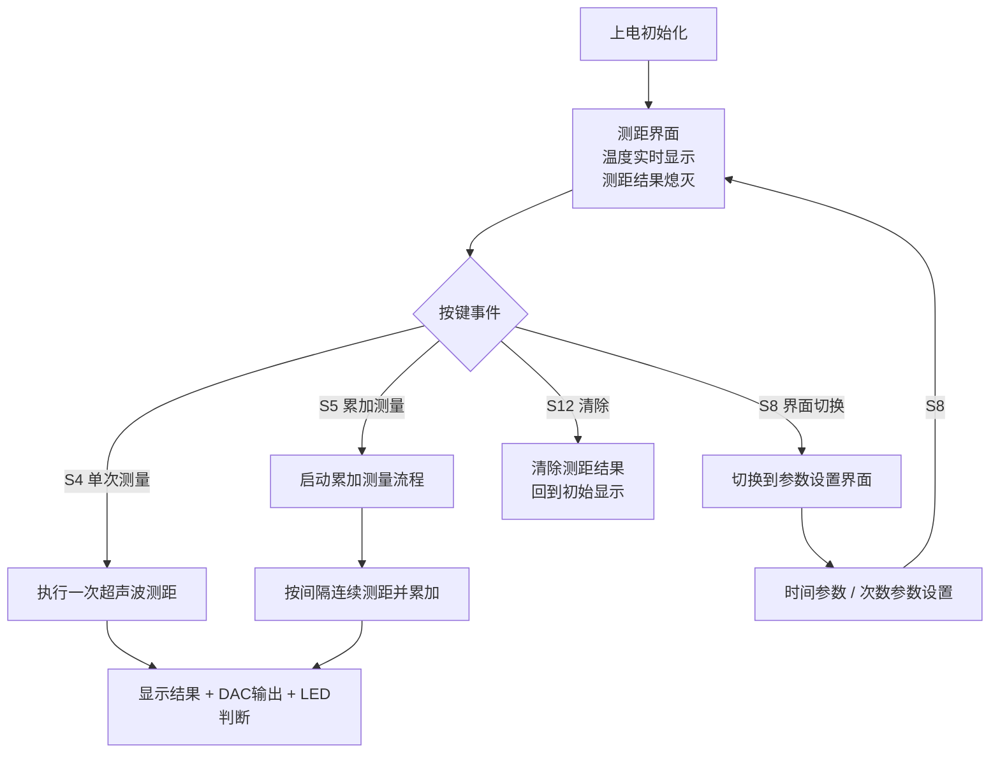
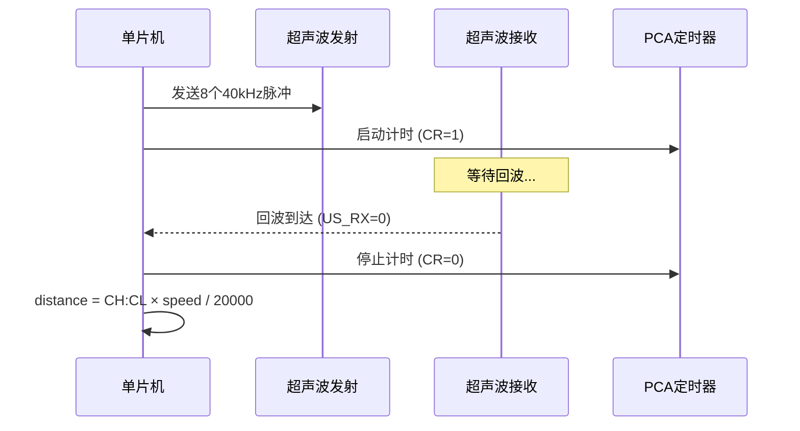
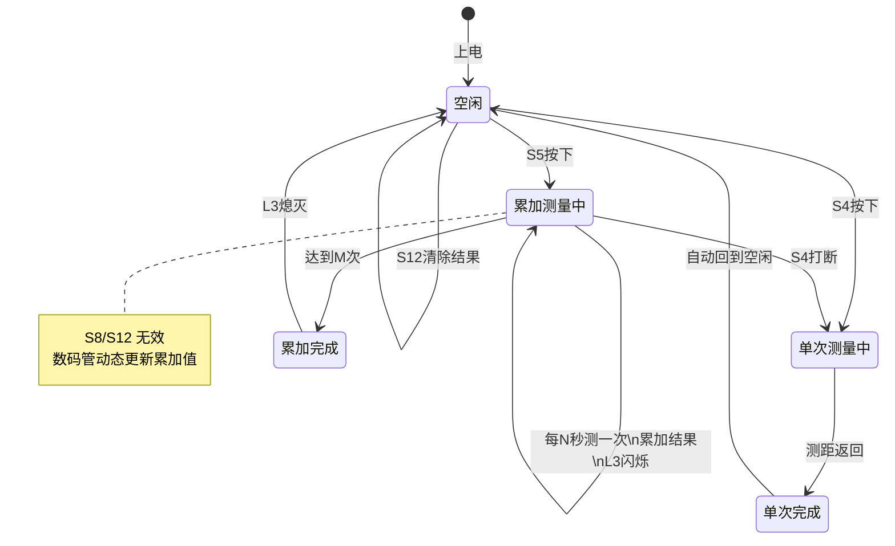
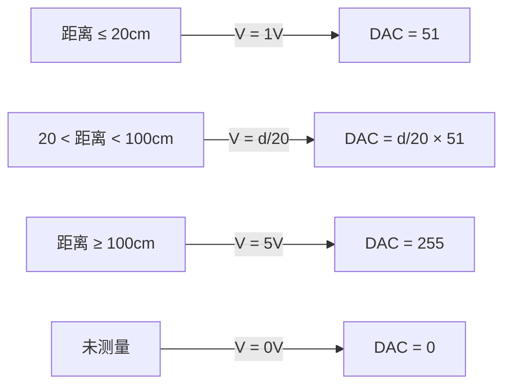
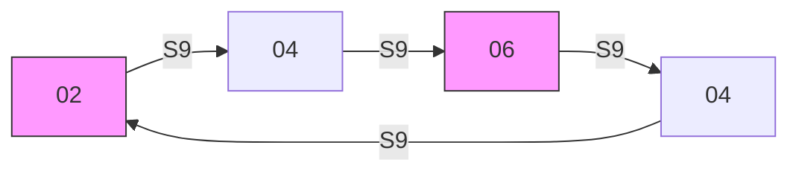
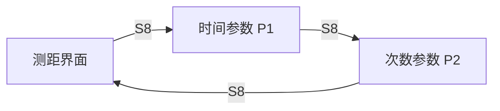
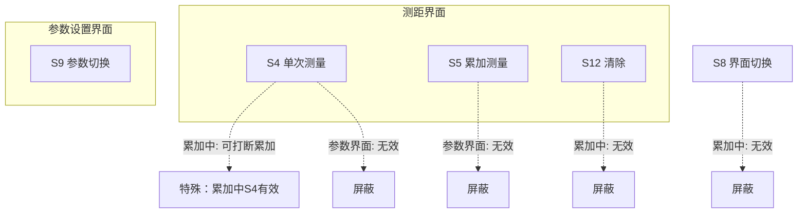

# 第十六届蓝桥杯单片机省赛（第二次）考点与难点分析

## 总览

本题综合考察超声波测距、DS18B20 温度采集、PCF8591 DAC 输出、数码管显示、矩阵键盘和 LED 控制，核心难点在于**累加测量的状态机设计**和**多模块协同调度**。

---

## 一、系统整体流程



---

## 二、考点一：超声波测距与温度补偿

### 考查内容

- 超声波发射（40kHz 方波）→ 等待回波 → PCA 计时 → 距离计算
- DS18B20 读取温度，动态修正声速 `v = 330 + 0.6T`

### 难点

1. **声速公式必须用实时温度**，不能写死常量。这意味着温度采集模块和超声波测距模块必须协同工作。
2. **PCA 计时器的理解**：使用 CMOD/CH/CL 对超声波回波计时，12T 模式下 1us 计数一次，距离公式为 `d = time × v / 20000`（除以 2 是往返，除以 10000 是单位换算 us→s 和 m→cm）。
3. **超时保护**：如果超声波无回波，必须依赖 PCA 溢出（CF 标志）退出，否则程序卡死。



---

## 三、考点二：累加测量状态机（最大难点）

### 考查内容

按下 S5 后，系统以**固定时间间隔**连续测距**若干次**，结果逐次累加。时间间隔和测距次数均可在参数界面设置。

### 难点

1. **"立即启动首次测距"**：按下 S5 后不能等一个间隔才开始，必须马上执行第一次。
2. **间隔定时与次数计数**：后续每隔 N 秒触发一次测距，总共测 M 次，中间数码管要动态更新累加值。
3. **过程中的按键屏蔽**：累加测量进行中 S8（界面切换）和 S12（清除）无效，但 S4（单次测量）可以打断累加。
4. **L3 闪烁控制**：累加过程中 L3 以 0.1s 间隔闪烁，完成后立即熄灭。



### 实现思路

采用调度器动态修改 `Get_Distance` 任务的执行间隔（`rate_ms`），配合 `summation_flag` 和 `summation_index` 控制流程：

| 阶段 | summation_flag | summation_index | 行为 |
|------|:-:|:-:|------|
| 按下 S5 | 1 | 0 | 立即执行首次测距，修改调度间隔为 N 秒 |
| 间隔到达 | 1 | 1~M-1 | 执行测距并累加 |
| 最后一次 | 0 | 归零 | 停止累加，显示最终结果 |

---

## 四、考点三：DAC 输出线性映射

### 考查内容

将测距结果映射为 1~5V 的 DAC 输出。

### 难点

这个线性映射的分段公式需要从图中读出：

```
距离 d (cm)    电压 V (V)     DAC值 (0~255)
─────────────────────────────────────────
  ≤ 20          1.0            51
  20 ~ 100      线性           51 ~ 255
  ≥ 100         5.0            255
  未测量         0.0            0
```

**映射公式**：`V = d / 20`（当 20 ≤ d ≤ 100 时），DAC 写入值 = `V × 51`。



### 关键细节

- DAC 输出只在**测量完成后**更新，测量过程中保持不变（通过 `signal_flag` / `summation_flag` 判断）。
- 未执行任何有效测量时输出 0V，这是一个独立状态。

---

## 五、考点四：S9 参数往复切换

### 考查内容

S9 按键切换参数值，切换模式为**往复（乒乓）**而非简单循环。

### 难点

```
时间参数：02 → 04 → 06 → 04 → 02 → 04 → 06 → 04 → ...
次数参数：03 → 05 → 07 → 05 → 03 → 05 → 07 → 05 → ...
```

这不是 `2→4→6→2→4→6` 的简单循环！是 `2→4→6→4→2→4→6→4` 的往复。



### 巧妙解法

将往复序列展开为数组 `{2, 4, 6, 4}`，取模循环 `index = (++index) % 4`，自动实现往复效果，无需维护方向标志。

---

## 六、考点五：界面切换与显示管理

### 考查内容

三个界面循环切换：测距界面 → 时间参数界面 → 次数参数界面 → 测距界面。



### 难点

1. **数码管高位熄灭**：测距结果不足 4 位时高位必须熄灭（不是显示 0），需要逐位判断。
2. **参数界面固定补零**：参数值 < 10 时高位补 0（如 `02`、`05`），与测距界面的熄灭规则不同。
3. **特殊字符段码**：需要 A、C、E、P 四个字母的段码，容易遗漏或写错。
4. **切换界面不影响后台**：切到参数界面后，温度采集和 DAC 输出必须继续正常运行。

### 显示状态总结

| 界面 | 位1 | 位2 | 位3-4 | 位5-8 |
|------|-----|-----|-------|-------|
| 测距-初始 | C | C | 温度 | 熄灭 |
| 测距-单次 | A | C | 温度 | 距离（高位熄灭） |
| 测距-累加 | E | C | 温度 | 累加值（高位熄灭） |
| 时间参数 | P | 1 | 熄灭 | 补零 + 值 |
| 次数参数 | P | 2 | 熄灭 | 补零 + 值 |

---

## 七、考点六：LED 指示灯逻辑

### 三个 LED 的控制规则

| LED | 条件 | 特殊要求 |
|-----|------|----------|
| L1 | 当前在测距界面时亮 | 切到参数界面立即灭 |
| L2 | 最终结果 < 20cm 或 > 100cm 时亮 | 累加**过程中状态不变**（不更新） |
| L3 | 累加测量进行中 0.1s 闪烁 | 测量完成后**立即熄灭** |

### 难点

- L2 的"累加过程中状态不变"：意味着在 `summation_flag==1` 期间不能更新 L2，要保持按下 S5 之前的状态。
- L3 的闪烁建议放在定时器中断中计时（1ms 中断 × 100 = 100ms），不受主循环中超声波阻塞的影响。

---

## 八、考点七：按键屏蔽与互斥

这是最容易扣分的细节部分。



### 屏蔽规则总结

| 按键 | 测距界面-空闲 | 测距界面-累加中 | 参数界面 |
|------|:---:|:---:|:---:|
| S4 | 启动单次 | **打断累加+单次** | 无效 |
| S5 | 启动累加 | 有效（重启） | 无效 |
| S8 | 切换界面 | **无效** | 切换界面 |
| S9 | 无效 | 无效 | 切换参数 |
| S12 | 清除结果 | **无效** | 无效 |

---

## 九、综合难度评估

| 模块 | 难度 | 说明 |
|------|:---:|------|
| 超声波测距 | ★★★ | PCA 计时 + 温度补偿声速 |
| 累加测量状态机 | ★★★★★ | 本题最大难点，状态转换多，边界条件复杂 |
| DAC 线性映射 | ★★ | 公式推导 + 分段处理 |
| 参数往复切换 | ★★ | 理解往复 vs 循环的区别 |
| 界面显示管理 | ★★★ | 三个界面 + 多种显示状态 |
| LED 状态控制 | ★★★ | L2 累加中不变 + L3 定时闪烁 |
| 按键屏蔽逻辑 | ★★★★ | 不同界面/状态下的互斥规则多 |
| 整体调度架构 | ★★★ | 多任务协调，阻塞操作的影响 |

### 拿分策略建议

1. **先搭框架**：任务调度器 + 界面切换 + 数码管显示（基础分）
2. **再做温度和单次测距**：DS18B20 + 超声波单次（中等分）
3. **然后做 DAC 和 LED**：输出控制（稳定分）
4. **最后攻克累加测量**：状态机 + 按键屏蔽（高分区）
