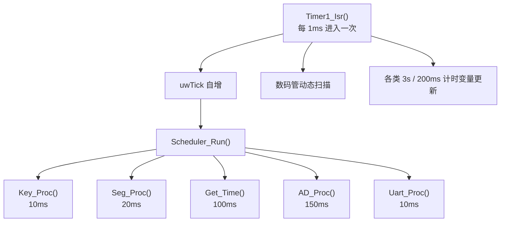
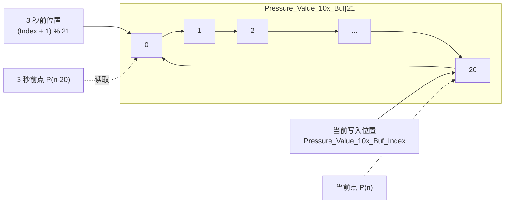
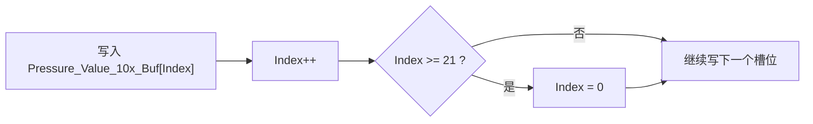
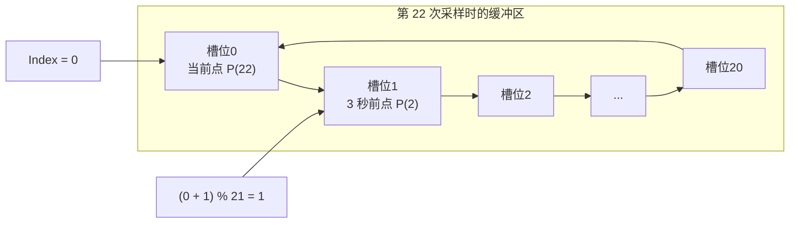
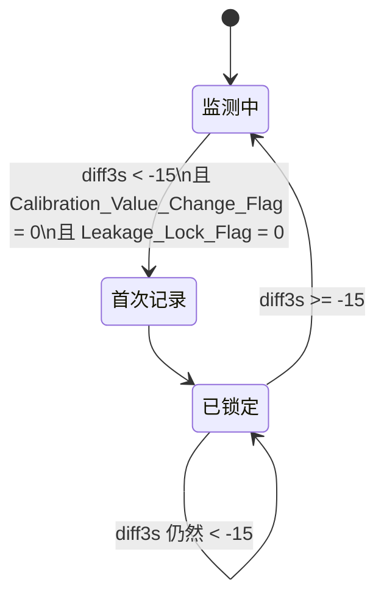

---
author:米醋工作室_左岚
---


# SCMA_17PD 考点讲解

## 1. 说明

本文基于题目和工程源码，对本题的主要考点进行讲解：

- 题目 [`SCMA_17PD.pdf`](./SCMA_17PD.pdf)
- 源码 [`src/user/main.c`](../src/user/main.c) 及相关驱动

本文遵循两个原则：

- 先说明题目要求，再说明工程中的实现方式。
- 凡是程序中没有落地的内容，不写成“已实现考点”。

例如，压力值趋势变量、额外状态机、辅助重置函数等扩展写法并未出现在程序中，因此本文不再展开。

## 2. 工程整体结构

工程的核心控制逻辑主要集中在 `src/user/main.c`，驱动层负责提供底层读写接口：

- `driver/iic.c`：PCF8591 ADC 读取、AT24C02 EEPROM 读写
- `driver/ds1302.c`：RTC 时间读写
- `driver/key.c`：矩阵键盘扫描
- `driver/seg.c`：数码管动态扫描显示
- `driver/led.c`：LED 显示
- `driver/uart.c`：串口 1 初始化和 `printf` 输出

主程序采用“定时中断 + 任务轮询”的结构：

- `Timer1_Isr()` 每 1ms 进入一次，负责系统节拍 `uwTick`、数码管扫描和若干计时变量更新。
- `Scheduler_Run()` 根据周期调度各个任务函数。

任务表如下：

```c
idata task_t Scheduler_Task[] = {
    {Led_Proc, 1, 0},
    {Key_Proc, 10, 0},
    {Seg_Proc, 20, 0},
    {Get_Time, 100, 0},
    {AD_Proc, 150, 0},
    {Uart_Proc, 10, 0},
};
```

这对应了几个重要考点：

- 用 `1ms` 中断提供统一时基
- 通过任务分时调度把按键、显示、采样、串口拆开
- 满足题目对采样周期、按键响应时间、LED 响应时间的要求

可以用下面这张图理解整个调度关系：



其中最关键的周期关系是：

- 按键扫描周期 `10ms`
- 时间读取周期 `100ms`
- 压力采样周期 `150ms`

泄压记录功能里“3 秒前压力值”的计算，就是建立在 `150ms` 周期采样基础上的。

## 3. 上电初始化考点

题目要求系统首次上电时写入默认参数。工程在 `main()` 中通过 EEPROM 特征字完成这一点：

```c
EEPROM_Read(&temp, 0x00, 1);
if (temp == 0xaa)
{
    EEPROM_Read(temp_buf, 0x01, 3);
    PL_10x = temp_buf[0];
    PH_10x = temp_buf[1];
    Device_Address = temp_buf[2];
}
else
{
    Device_Address = 8;
    PH_10x = 90;
    PL_10x = 0;
    EEPROM_Write(&Device_Address, 0x03, 1);
    EEPROM_Write(&PH_10x, 0x02, 1);
    EEPROM_Write(&PL_10x, 0x01, 1);
    temp = 0xaa;
    EEPROM_Write(&temp, 0x00, 1);
}
```

这里对应的考点有三层：

1. 特征字 `0xAA` 用来区分“首次上电”和“正常重启”。
2. 校准值按放大 10 倍后的整数存储。
3. 地址、PH、PL 都会掉电保存。

工程中的 EEPROM 地址分配也与题目一致：

- `0x00`：特征字
- `0x01`：`PL_10x`
- `0x02`：`PH_10x`
- `0x03`：设备地址

## 4. 压力测量考点

### 4.1 模拟量采集来源

压力值来自 PCF8591 的 ADC 采样，代码位于 `AD_Proc()`：

```c
ad_value = Ad_Read(0x03);
```

`Ad_Read()` 由 `driver/iic.c` 提供，本质上是通过 I2C 访问 PCF8591，并读取 8 位 ADC 值。

### 4.2 双点标定换算公式

题目要求压力值随电压线性增加，并支持零点 `PL` 与满量程 `PH` 双点标定。工程直接使用线性公式：

```c
Pressure_Value_10x = (PH_10x - PL_10x) * ad_value / 255 + PL_10x;
```

其中：

- `Pressure_Value_10x`：当前压力值，单位为 `0.1kPa`
- `PH_10x`：满量程校准值，单位同样是 `0.1kPa`
- `PL_10x`：零点校准值，单位同样是 `0.1kPa`
- `ad_value`：PCF8591 返回的 `0~255` 采样值

这段公式对应的数学含义是：

```text
0    -> PL
255  -> PH
```

用放大 10 倍后的整数做运算，有两个好处：

- 避免 51 单片机使用浮点运算
- 方便 EEPROM 存储和数码管显示

例如：

- `9.0kPa` 存成 `90`
- `4.8kPa` 存成 `48`

## 5. 泄压记录考点

泄压记录是本题最关键的分析点之一，工程中已经采用了完整的实现链路。

### 5.1 题目要求怎么翻译成代码

题目原文是：

```text
若当前压力值与 3 秒前的压力值之差小于 -1.5kPa，
则触发泄压事件并记录当前时间，
压力持续下降或压力上升过程中，不重复记录。
```

对应到代码，必须解决三个问题：

1. 怎么拿到“3 秒前”的压力值
2. 怎么表示阈值 `-1.5kPa`
3. 怎么防止同一次泄压过程被重复记录

### 5.2 为什么是 21 个点的环形缓冲区

工程中的采样周期是 `150ms`：

```c
{AD_Proc, 150, 0}
```

所以：

```text
3s / 150ms = 20
```

这 20 表示的是“采样间隔数”，不是采样点个数。

如果当前采样点记作 `P(n)`，那么 3 秒前对应的是 `P(n-20)`。  
从 `P(n-20)` 到 `P(n)` 一共需要覆盖 21 个采样点，因此程序定义了：

```c
idata unsigned char Pressure_Value_10x_Buf[21] = {0};
idata unsigned char Pressure_Value_10x_Buf_Index = 0;
bit Pressure_Vlaue_10x_Buf_Full = 0;
```

这就是本题的核心数据结构：

- `Pressure_Value_10x_Buf[21]`：保存最近 21 次压力值
- `Pressure_Value_10x_Buf_Index`：当前写指针
- `Pressure_Vlaue_10x_Buf_Full`：缓冲区是否已经积满 21 个有效采样点

这里的“环形缓冲区”可以先按一句话理解：

```text
它本质上还是数组，只是不再搬移旧数据，而是让写指针在数组里循环前进。
```

普通数组如果想始终保存“最近 21 个点”，每来一个新值，就要把旧数据整体左移一格；  
环形缓冲区不这么做，它只做两件事：

1. 把新采样值写到当前下标位置。
2. 让下标加 1，若到达数组末尾就回到 0。

这样做的好处是：

- 时间开销固定，每次只写 1 个元素
- 不需要整体搬移数组
- 很适合 51 单片机这种资源有限的场景

可以把它想成一个“圆盘刻度”：

- 数组槽位固定是 `0 ~ 20`
- 写指针每次往前走一格
- 走到 `20` 以后，再走一步就回到 `0`
- 当缓冲区写满后，新数据会覆盖最旧的数据

缓冲区从“未写满”到“写满后循环覆盖”的过程如下：

```text
第 1 次采样：写入槽位 0
第 2 次采样：写入槽位 1
...
第 21 次采样：写入槽位 20，此时刚好凑齐 21 个点
第 22 次采样：写入槽位 0，覆盖最早那一个点
第 23 次采样：写入槽位 1，继续覆盖更早的数据
```

这也就是 `Pressure_Vlaue_10x_Buf_Full` 存在的原因：

- 在缓冲区还没写满 21 个点之前，系统没有完整的“3 秒前数据”
- 只有 `Pressure_Vlaue_10x_Buf_Full == 1` 后，才允许开始做泄压判定

环形缓冲区的逻辑关系可以简化为下面这张图：



如果把写指针的移动过程单独看，可以再理解成下面这个循环：



为了把“回绕”和“3 秒前取值”看得更具体，可以直接看第 22 次采样这个例子：

```text
前 21 次采样结束后：
槽位 0 ~ 20 已全部写满
此时 Index 已回到 0

第 22 次采样到来时：
1. 把新的压力值写入槽位 0
2. 这一步会覆盖最早那一个历史点
3. 当前点就是槽位 0
4. 3 秒前的点应当是槽位 1
```

这时程序中的取值关系就是：

```c
Pressure_Value_10x_Buf_Index = 0;
p_now = Pressure_Value_10x_Buf[0];
p_old = Pressure_Value_10x_Buf[(0 + 1) % 21];
// 即 p_old = Pressure_Value_10x_Buf[1]
```

可以把这个例子画成下面这张图：



这个例子说明了一件很关键的事：

- “当前点前 20 个采样间隔”并不一定在数组下标上表现为“减 20”
- 在长度为 21 的环形结构里，它完全可以等价写成“加 1 再取模”

### 5.3 为什么“3 秒前”取 `(index + 1) % 21`

当前值先写入当前位置：

```c
Pressure_Value_10x_Buf[Pressure_Value_10x_Buf_Index] = Pressure_Value_10x;
```

缓冲区长度是 21，所以在模 21 的意义下：

```text
-20 == +1
```

也就是说，“当前点往前数 20 个采样点”，等价于“当前点往后看 1 个槽位”。

因此程序直接这样取 3 秒前的值：

```c
pressure_old = Pressure_Value_10x_Buf[(Pressure_Value_10x_Buf_Index + 1) % 21];
```

这个写法与环形缓冲区的推导一致，也是本题实现中的关键考点。

### 5.4 阈值为什么写成 `-15`

代码里的压力值都是按 `0.1kPa` 存储，所以题目中的 `-1.5kPa` 会被转换成整数阈值：

```c
leak_cond_now = (diff3s < -15);
```

其中：

```c
diff3s = pressure_now - pressure_old;
```

因此：

- `diff3s < -15` 等价于“当前压力值比 3 秒前至少下降了 1.5kPa 以上”

### 5.5 为什么还要有 `Leakage_Lock_Flag`

如果只写成“满足条件就记录一次时间”，那么在压力连续下降期间，每 150ms 都可能再次满足条件，最终会重复记录很多次，不符合题目要求。

因此程序中增加了一个过程锁：

```c
bit Leakage_Lock_Flag = 0;
```

判定逻辑如下：

```c
if ((!Calibration_Value_Change_Flag) &&
    (leak_cond_now) &&
    (!Leakage_Lock_Flag))
{
    Leakage_Lock_Flag = 1;
    Pressure_Relief_Flag = 1;
    Read_Rtc(Pressure_Relief_Flag_ucRtc);
}

if ((Leakage_Lock_Flag) && (!leak_cond_now))
{
    Leakage_Lock_Flag = 0;
}
```

这段逻辑的含义是：

- 当前不在校准屏蔽期
- 当前满足泄压条件
- 本轮泄压还没有记录过

才允许触发一次记录。

一旦记录成功：

- `Leakage_Lock_Flag = 1`，本轮过程锁住
- `Pressure_Relief_Flag = 1`，表示系统已经存在最近一次泄压记录
- `Pressure_Relief_Flag_ucRtc[]` 保存触发时刻

之后只要 `diff3s` 仍然满足泄压条件，就不会重复记录。  
直到某一次比较结果已经不满足 `diff3s < -15`，代码才会执行解锁：

```c
Leakage_Lock_Flag = 0;
```

这正是题目“持续下降或上升过程中不重复记录”的代码化表达。

对应的判定流程可以画成下面这张状态图：



### 5.6 这部分考点里哪些内容没有写进代码

下面这些内容属于常见扩展写法，但工程中并没有实现，因此本文不再把它们当作已落地考点展开：

- 压力变化趋势变量
- 上一次压力值缓存变量
- 专门的历史缓冲清空函数
- 单独的泄压状态机枚举

工程中真正落地的泄压记录实现，核心变量如下：

- `Pressure_Value_10x_Buf[21]`
- `Pressure_Value_10x_Buf_Index`
- `Pressure_Vlaue_10x_Buf_Full`
- `Leakage_Lock_Flag`

## 6. 校准值与 3 秒屏蔽考点

题目要求：

```text
退出工厂模式后，校准值生效。
若任一校准值发生变化，3 秒内屏蔽泄压判定。
```

工程在退出工厂模式时完成这个逻辑：

```c
Calibration_Value_Change_Flag = (PH_10x != PH_10x_Ctrl ||
                                 PL_10x != PL_10x_Ctrl);
time_3s_cal = 0;
PH_10x = PH_10x_Ctrl;
PL_10x = PL_10x_Ctrl;
```

这段代码说明：

- 只有退出工厂模式时，控制值才真正写回工作值
- 如果 PH 或 PL 有变化，就拉起 `Calibration_Value_Change_Flag`
- 同时将 `time_3s_cal` 清零，重新开始计时

`Timer1_Isr()` 中负责完成 3 秒计时：

```c
if (Calibration_Value_Change_Flag)
{
    if (++time_3s_cal >= 3000)
    {
        time_3s_cal = 0;
        Calibration_Value_Change_Flag = 0;
    }
}
else
{
    time_3s_cal = 0;
}
```

而 `AD_Proc()` 的泄压判定前又专门判断：

```c
(!Calibration_Value_Change_Flag)
```

所以这一段的完整考点链路是：

1. 退出工厂模式
2. 检查校准值是否发生变化
3. 若发生变化，拉起 3 秒屏蔽标志
4. 在 3 秒内禁止泄压判定
5. 计时结束后自动恢复判定

## 7. 显示功能考点

### 7.1 数码管显示由 `Seg_Proc()` 统一组织

工程中的所有界面都通过 `Seg_Proc()` 组织显示数据，再由 `Timer1_Isr()` 调用 `Seg_Disp()` 做动态扫描。

考点在于：

- 业务层只负责准备 `Seg_Buf[8]`
- 中断层只负责“逐位扫描”

这是典型的“显示数据准备”和“显示刷新”分离。

### 7.2 三个常规界面

非工厂模式下，`Seg_Show_Mode` 负责切换三个界面：

- `0`：运行界面
- `1`：地址设置界面
- `2`：泄压记录界面

#### 运行界面

显示内容：

- `ucRtc[0]` 小时
- `ucRtc[1]` 分钟
- `Pressure_Value_10x` 压力值

对应题目里的“时间 + 当前压力值”。

#### 地址设置界面

显示内容：

- 左侧显示 `AE`
- 右侧三位显示 `Device_Address`

代码对高位做了条件熄灭处理：

```c
Seg_Buf[5] = (Device_Address >= 100) ? Device_Address / 100 % 10 : 10;
Seg_Buf[6] = (Device_Address >= 10) ? Device_Address / 10 % 10 : 10;
Seg_Buf[7] = Device_Address % 10;
```

这里的 `10` 在段码表中代表熄灭。

#### 泄压记录界面

显示内容：

- 左侧显示 `CC`
- 若 `Pressure_Relief_Flag == 1`，显示最近一次泄压时间
- 否则显示空白和 `-`

这与题目的界面要求一致。

### 7.3 工厂模式界面

工厂模式下不再看 `Seg_Show_Mode`，而是直接显示：

- `PH` + `PH_10x_Ctrl`
- `PL` + `PL_10x_Ctrl`

其中 `Calibration_Interface` 用于决定当前正在调的是 PH 还是 PL。

考点在于：

- `PH_10x_Ctrl`、`PL_10x_Ctrl` 是工厂模式下的临时控制值
- `PH_10x`、`PL_10x` 是真正参与压力换算的工作值
- 只有退出工厂模式时，控制值才覆盖工作值

## 8. 按键功能考点

### 8.1 扫描与边沿检测

按键底层扫描在 `driver/key.c`，主逻辑在 `Key_Proc()`：

```c
Key_Down = Key_Val & (Key_Val ^ Key_Old);
Key_Up = ~Key_Val & (Key_Val ^ Key_Old);
Key_Old = Key_Val;
```

这组写法的意义是：

- `Key_Down`：按下边沿
- `Key_Up`：松开边沿

再配合 `Key_Proc()` 每 `10ms` 调一次，实现按键响应。

### 8.2 S4 界面切换

程序中：

```c
Seg_Show_Mode = (Seg_Show_Mode + 1) % 3;
```

这正对应题目的三个主界面循环切换。

### 8.3 S5 工厂模式

S5 的考点分两部分：

- 长按 3 秒进入或退出工厂模式
- 工厂模式下短按切换 PH / PL

代码通过这几个变量实现长按识别：

- `time_3s_factory`
- `time_3s_factory_flag`
- `time_3s_factory_flag_running`

这是典型的“起按启动计时，达到阈值只执行一次，松手后清状态”的长按实现。

### 8.4 S8 / S9 调参数

非工厂模式下：

- 在地址设置界面调整 `Device_Address`

工厂模式下：

- 调整 `PH_10x_Ctrl` 或 `PL_10x_Ctrl`

这里也体现出一个考点：  
同一组按键在不同界面下复用，但必须受界面状态约束，不能串功能。

### 8.5 S12 保存

程序中，S12 只负责写 EEPROM，不负责立即切换界面，也不负责退出工厂模式。

对应逻辑：

- 地址界面下保存 `Device_Address`
- 工厂模式下保存 `PH_10x_Ctrl` 或 `PL_10x_Ctrl`

### 8.6 S13 清除 / 恢复出厂

S13 有两个功能：

- 短按：在泄压记录界面清除记录
- 长按 3 秒：恢复默认地址和校准值

程序中，S13 短按清除记录的实现是：

```c
Pressure_Relief_Flag_ucRtc[0] = 0;
Pressure_Relief_Flag_ucRtc[1] = 0;
Pressure_Relief_Flag_ucRtc[2] = 0;
Pressure_Relief_Flag = 0;
```

这里需要注意一个实现细节：

- 程序短按 S13 时只清除了记录时间和 `Pressure_Relief_Flag`
- 没有同步清除 `Leakage_Lock_Flag`

因此在讲解时，应将其理解为“清除显示记录”，而不应进一步表述为“已完成全部相关状态复位”。

## 9. 串口通信考点

### 9.1 串口参数

`driver/uart.c` 中 `Uart1_Init()` 已按题目要求配置为：

```text
9600, 8, N, 1
```

### 9.2 通信处理流程

串口接收采用中断收字节：

- `Uart1_Isr()` 把数据写入 `Uart_Rx_Buf[]`
- `Uart_Proc()` 每 `10ms` 检查一次接收超时并解析命令

这属于“中断接收 + 任务解析”的常见设计。

### 9.3 命令解析特点

程序通过下面的格式解析命令：

```c
rev = sscanf((char *)Uart_Rx_Buf, "#%u?%n", &id, &n);
if ((rev == 1) && (n == 5) && (id == Device_Address))
```

返回格式为：

```c
printf("%bu.%bukPa@%.2bu:%.2bu",
       Pressure_Value_10x / 10,
       Pressure_Value_10x % 10,
       Pressure_Relief_Flag_ucRtc[0],
       Pressure_Relief_Flag_ucRtc[1]);
```

按本工程的实现方式，这一部分的考点是：

- 命令头和尾分别用 `#` 与 `?`
- 只有地址匹配才回应
- 返回内容是“压力值 + 最近一次记录时间的时分”

需要特别说明的是：

- 程序额外检查了 `n == 5`
- 因此它实际更贴近固定 5 字符命令，例如 `#001?`

这属于本工程的实现口径，讲解时不宜直接泛化成任意长度地址字符串。

## 10. LED 指示考点

`Led_Proc()` 中三个 LED 的含义很清楚：

```c
ucLed[0] = Led_Uart_Flag;
ucLed[1] = Led_Factory_Flag;
ucLed[2] = Pressure_Relief_Flag;
```

对应关系为：

- `L1`：串口通信指示
- `L2`：工厂模式指示
- `L3`：泄压事件指示

其中：

- `L3` 最直接，跟随 `Pressure_Relief_Flag`
- `L1` 由串口收到本机命令后启动 3 秒闪烁逻辑
- `L2` 设计意图是工厂模式闪烁

这里还需要补充一个实现说明：

- `L3` 的逻辑是明确且已经接通的
- `L1` 的 3 秒闪烁计时链路也是完整的
- `L2` 虽然已经设置了 `time_200ms_factory` 和 `Led_Factory_Flag` 两个变量，但 `Timer1_Isr()` 中这段计时写法会在未到 200ms 时把计数清零，因此不宜表述为“已经稳定实现 0.2 秒闪烁”

因此，L2 更适合按下面三层来讲：

- 题目考点：工厂模式灯 0.2 秒闪烁
- 工程设计意图：通过 `time_200ms_factory` 实现
- 实现说明：现有计时逻辑尚未形成完整的 0.2 秒翻转效果

## 11. 本题最值得背下来的几个“为什么”

### 11.1 为什么压力值全部按 10 倍整数保存

因为：

- 方便 EEPROM 存储
- 方便数码管显示
- 避免 51 单片机浮点开销

### 11.2 为什么泄压记录要用环形缓冲区

因为题目比较的是：

```text
当前值 - 3 秒前的值
```

不是“当前是否下降”，也不是“连续几次是否下降”。

### 11.3 为什么缓冲区长度必须是 21

因为：

```text
3 秒 / 150ms = 20 个采样间隔
20 个采样间隔对应 21 个采样点
```

### 11.4 为什么还要再加一个锁

因为题目明确要求：

```text
压力持续下降或压力上升过程中，不重复记录
```

所以必须把“一次泄压过程”视为一个整体，不能每次满足阈值都记录。

### 11.5 为什么校准值变化后要屏蔽 3 秒

因为校准值一变，压力换算基准就变了。  
如果不屏蔽，刚退出工厂模式就可能因为换算基准突变而误判成泄压事件。

## 12. 高频问答

### 12.1 为什么 `Pressure_Relief_Flag` 和 `Leakage_Lock_Flag` 不能合并

不能合并，因为两个变量职责不同：

- `Pressure_Relief_Flag` 表示“系统当前有没有最近一次泄压记录”，主要给显示和 L3 用
- `Leakage_Lock_Flag` 表示“这一轮泄压过程是否已经记过一次”，主要给去重逻辑用

### 12.2 为什么要等缓冲区装满后才开始判定

因为只有装满 21 个采样点以后，系统才真正拥有“当前值”和“3 秒前的值”这一对完整数据。

### 12.3 为什么泄压时间不直接用 `ucRtc`

因为 `ucRtc` 是系统当前时间缓存，会不断刷新。  
一旦发生泄压，必须把触发瞬间的时间单独保存到 `Pressure_Relief_Flag_ucRtc[]`。

### 12.4 为什么工厂模式调的是 `PH_10x_Ctrl` `PL_10x_Ctrl`

因为工厂模式下只是“编辑参数”，不是立即生效。  
只有退出工厂模式时，控制值才写回工作值，这样才能满足题目要求。

## 13. 总结

从本工程的实现路径来看，这道题最核心的得分点有四个：

1. 用 ADC + 双点标定完成压力换算。
2. 用 `21` 点环形缓冲区实现“当前值与 3 秒前的值比较”。
3. 用 `Leakage_Lock_Flag` 做泄压过程去重。
4. 用“任务调度 + 1ms 节拍”把按键、显示、采样、串口拆开运行。

如果只记一句话，这题的核心不是“检测下降趋势”，而是：

```text
在 150ms 周期采样的前提下，
用 21 个点的环形缓冲区比较当前压力值和 3 秒前压力值，
并用过程锁避免同一次泄压重复记录。
```
